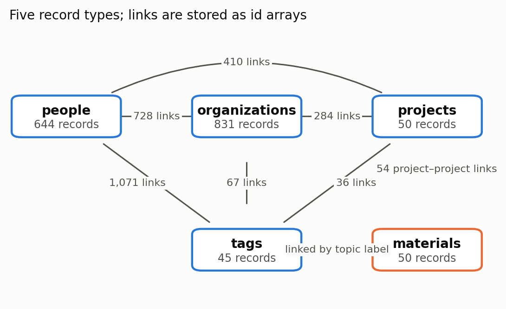
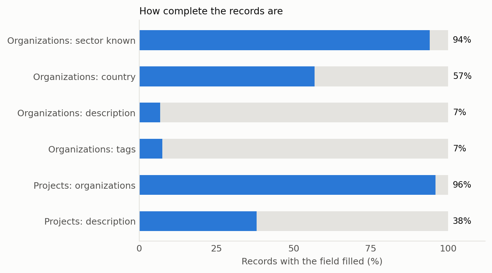
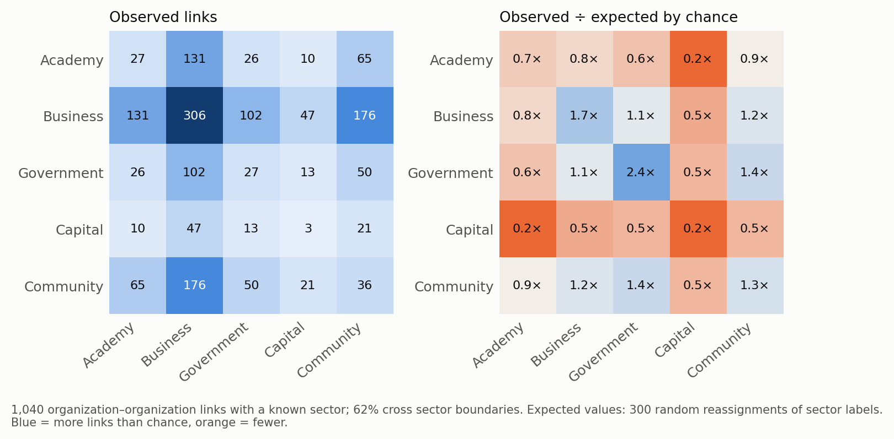
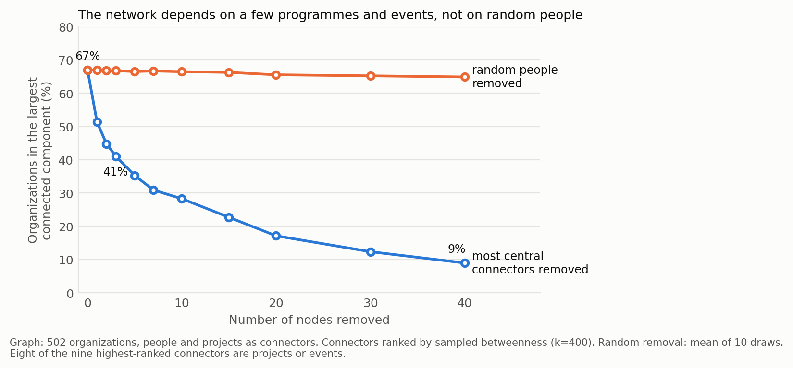
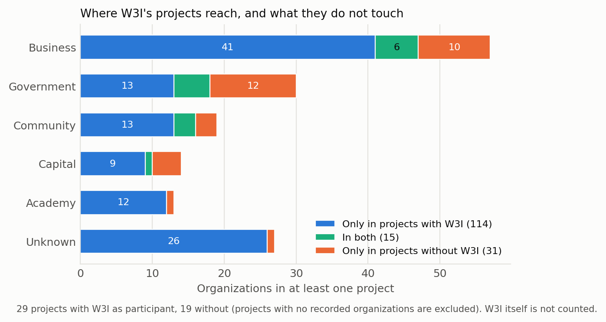

# The W3I Ecosystem Dataset: a relational map of Ukraine's Web3, academic and public-sector network

Max Semenchuk, Web3 Institute

*Version 1.0. All numbers can be reproduced with the scripts in `analysis/`.*

## Abstract

Studies of national Web3 ecosystems usually rely on company counts from commercial databases or on one-off surveys. They rarely describe who is connected to whom across the academic, business, government and funding sectors. We present the W3I Ecosystem Dataset: 831 organizations, 644 people (name and affiliation only), 50 projects and 45 topic tags, linked by people, projects and tags, together with a catalogue of 50 reports, talks and articles published by W3I. The data was assembled by the Web3 Institute (W3I) while running forums, education programs and research since 2023. It is published as JSON and CSV with a data dictionary and reproducible analysis scripts. We use three short analyses to show what the dataset can answer: how strongly organizations mix across sectors, what holds the network together, and how far one institute's projects reach compared with projects it does not take part in. In this snapshot, sectors mix more than they cluster, individuals rarely bridge sectors, and connectivity depends on a small number of programs and events. We state clearly that this is a view of the network visible to W3I, not a census, and describe how the design supports comparison with other countries.

**Keywords:** Web3, blockchain, ecosystem mapping, network analysis, Ukraine, open data, observatory.

## 1. Background and motivation

Governments, donors and researchers who want to develop a Web3 ecosystem need to know more than how many startups exist. They need to know whether universities talk to companies, whether public agencies have partners, where funding meets builders, and which links would break if a few actors left. Commercial company databases give counts but not relations; surveys give opinions but are hard to repeat.

Ukraine is a useful case. It has an unusually active public-sector digitalization agenda, a large developer community, a history of early blockchain pilots in public registries (2017–2018), and a wartime context that makes resilience a practical question.

The dataset was built for three purposes: (1) as the working base of W3I's own network and research programmes; (2) as shared material for colleagues at partner institutes who need the same facts without access to the operational CRM; (3) as a prototype of an **ecosystem observatory**, a country-agnostic schema that could be filled for other countries and compared.

## 2. Methods

### 2.1 Sources and construction

| Entity | Main source | Notes |
|---|---|---|
| Organizations | W3I CRM, built from forum and programme participation, partner lists, manual research | sector and country assigned by W3I |
| People | same CRM; contacts from forums and programmes, enriched from public professional profiles; a small number added from public press for pilots with no recorded participants | released as name and links only (see 2.2) |
| Projects | W3I programmes and partner initiatives, plus earlier public-sector blockchain pilots (2017–2021) | 29 of 50 involve W3I |
| Tags | W3I topic taxonomy | only tags in use |
| Materials | W3I website (`/learn`): reports, talks, articles | front matter of already published pages; no external literature corpus |

The CRM is a relational database; the public dataset is a one-way export. Only fields on an explicit allowlist leave the database, so new internal fields are not published by default.

### 2.2 Privacy and curation

- The data is a subset of what is already shown on the public W3I Explore map. It adds no information about people that the map does not show.
- **People are reduced to a minimum.** Only the name and the links to organizations, projects and topic tags are released. Biographies, locations, profile links, name variants and the internal field recording how a contact entered the database are held back. A person is released only if at least one organization is recorded for them (644 of 1,005 people in the working database).
- Emails, phone numbers, messenger handles, wallet addresses and private notes are never exported. Email- and phone-like strings inside free-text descriptions are masked automatically.
- People who signed up to W3I services (talent matching, wallet login, website registration) are excluded entirely (77 records).
- Individuals asked to take part as expert reviewers are not listed without their consent.
- Anyone can ask for removal by writing to the contact address in the repository. Records are removed in the next release; because archived versions persist, the dataset states this limit openly.

### 2.3 Schema

Each entity has a stable numeric id. Relations are arrays of ids (`organization_ids`, `project_ids`, `tag_ids`), so the data can be read as a graph without a database. All fields are in `docs/DATA_DICTIONARY.md`.

*Figure 1. The five record types and the links between them. Counts are links in the released data; materials are connected to tags by topic label, not by id.*

## 3. Data records

| File | Records | Content |
|---|---|---|
| `organizations` | 831 | name, sector, country, website, aliases, description, tags |
| `people` | 644 | name, linked organizations/projects/tags |
| `projects` | 50 | name, type (pilot, startup, research, course, event, policy…), organizations, related projects, tags |
| `tags` | 45 | name, category |
| `materials` | 50 | title, type, date, topic labels, excerpt, link to the page or PDF on w3i.network |

Formats: JSON (nested relations) and CSV (`;`-separated id lists).

## 4. Technical validation and limitations

The CI pipeline checks that all JSON parses, that every referenced id exists, and that no email or wallet pattern appears in the data. Beyond that, readers should be aware of the following.

1. **Sampling bias.** The data is the network *visible to W3I*. Most people came through forums and W3I programmes, so the results describe W3I's reach as much as the ecosystem. External validation against independent registries is a planned next step.
2. **Incomplete attributes.** Country is missing for about 43% of organizations, and most organizations carry no description or tags.
3. **Coarse sectors.** The analysis groups original sector labels into five groups (Academy, Business, Government, Capital, Community). "Business" mixes exchanges, products, protocols and law firms.
4. **No time dimension.** There are no founding dates, project start/end dates or activity status, so the dataset cannot yet be used for longitudinal analysis.
5. **Few projects.** Fifty projects, several earlier pilots with few or no recorded participants. We added eight publicly named participants for two pilots from press sources, recorded in the working database with their provenance; the structural results below did not change.
6. **Materials** are only what W3I itself has published, so they show W3I's output, not the literature on the topic.

*Figure 2. Share of records with each field filled. Sector and project–organization links are almost complete; organization descriptions and tags are rare.*

## 5. Usage notes: three illustrative analyses

All scripts are in `analysis/` and reproduce the numbers below.

### 5.1 Do sectors mix?

Of organization–organization links between organizations with a known sector, 62% cross sector boundaries, against about 73% expected if sector labels were assigned at random (assortativity 0.08). Sectors are therefore only weakly clustered. Most frequent cross-sector links: business–community, academia–business, business–government. Academia is the largest sector by organization count (131) but appears in about 9% of recorded projects.

*Figure 3. Left: number of organization–organization links for each pair of sectors. Right: the same counts divided by the number expected when sector labels are shuffled at random. Business–business and government–government links are more frequent than chance, links involving capital are rarer.*

### 5.2 Who holds the network together?

Individuals rarely bridge sectors: 28 of 644 people (4%) belong to organizations in two or more sector groups. With only person–organization links, 4% of organizations fall into the largest connected component. Including projects as connectors raises this to 67% (65% for Ukraine-based organizations). Removing the three most central connectors, mostly programmes and events, reduces it to 41%; removing 40 reduces it to 9%. Removing random people changes it by about one point. In this data, **programmes and events, not individuals, are the connective tissue.**

*Figure 4. Share of organizations in the largest connected component as the most central connectors (blue) or random people (orange) are removed. Eight of the nine highest-ranked connectors are projects or events.*

### 5.3 What does one institute's footprint look like?

Projects with W3I as a participant reach 129 other organizations (about one third Ukrainian, mostly business). Projects without W3I involve 46 organizations, of which 31 appear only there. These are mainly Ukrainian state agencies, donors and international bodies from earlier public-sector blockchain pilots. Only 15 organizations appear in both groups. The share of cross-sector links is 61% for projects with W3I and 70% for those without. A reader should treat this as a description of one institute's position, with the caveat that the non-W3I projects were probably recorded less completely.

*Figure 5. Organizations in projects with and without W3I as a participant, by sector. Government and capital are over-represented among organizations that appear only in projects without W3I.*

### 5.4 Questions the dataset can support

- Which types of organization are missing from a country's Web3 network (for example public agencies without a private-sector partner)?
- Which topics W3I publishes on have no matching project, and the reverse?
- With a time dimension: how does connectivity change after a policy event or a funding round?

## 6. Towards an observatory

Nothing in the schema is specific to Ukraine. A country observatory needs the same five record types and a small set of indicators computed from them: cross-sector connectivity, dependence on a few connectors, presence of public agencies and funders in projects, concentration in one city, and the flow from education to startups. A comparison with other countries would require (a) the same schema and sector grouping, (b) a documented collection procedure, and (c) a sampling-bias estimate for each. Priorities for the next release: founding year and activity status, funding records, a clean sector scheme, project dates, and provenance for every record.

## 7. Availability

The dataset is archived on Zenodo (https://doi.org/10.5281/zenodo.24141727; version 1.0.0: https://doi.org/10.5281/zenodo.24141728) and mirrored as a source repository (https://github.com/MaxSemenchuk/w3i-ecosystem-dataset). Licence: CC BY 4.0 for the data, MIT for the code in `analysis/`. New releases will be versioned; the working database remains the source of truth.

## 8. Ethics statement

The dataset contains named professionals, limited to their name and professional affiliations, which are already shown on the public W3I Explore map. Everything else about individuals is excluded by construction, and so are people who registered for services. A removal procedure exists, with the limit that archived versions persist. The analyses describe structural patterns and are not meant to rank or evaluate individuals; individual connectors are deliberately not named.

## References

**Method and data practice**

1. Wilkinson, M. D. et al. (2016). The FAIR Guiding Principles for scientific data management and stewardship. *Scientific Data*, 3, 160018. https://doi.org/10.1038/sdata.2016.18

**Ecosystem mapping**

2. EU Blockchain Observatory and Forum (2022). *EU Blockchain Ecosystem Developments* (updated edition; first edition 2020). European Commission. <https://blockchain-observatory.ec.europa.eu/publications/eu-blockchain-ecosystem-latest-developments-version2022_cs>
3. EU Blockchain Observatory and Forum (2024). *Conclusion of the third contractual round*. European Commission. <https://blockchain-observatory.ec.europa.eu/news/eu-blockchain-observatory-forum-concludes-third-contractual-round-comprehensive-report-highlighting-2024-05-24_en>
4. Bassi, E., Lustenberger, M. and Letina, S. (2025). Blockchain-based voluntary carbon market: strategic insights into network structure. *Frontiers in Blockchain*. https://doi.org/10.3389/fbloc.2025.1603695
5. Samiee, S. (2025). *Blockchain startups competitive ecosystem from the new entrants' point of view: a network-based empirical analysis*. PhD dissertation, University of Texas at Arlington. <https://mavmatrix.uta.edu/infosystemsopmanage_dissertations/79>

**Ukrainian context**

6. Cabinet of Ministers of Ukraine (2021). Resolution No. 179 of 3 March 2021, *On approval of the National Economic Strategy for the period up to 2030*. <https://nes2030.org.ua/>
7. Ministry of Justice of Ukraine (2017). SETAM switched to blockchain data storage and was renamed OpenMarket (6 September 2017). Government portal. <https://www.kmu.gov.ua/news/250248597>
8. Transparency International Ukraine (2017). Pilot project on moving the State Land Cadastre to blockchain: agreement of 16 June 2017 between the State E-Government Agency, Transparency International Ukraine and Bitfury. <https://ti-ukraine.org/en/?p=4499>
9. CoinDesk (2017). Ukrainian Government to Start Blockchain Land Registry Trial in October. <https://www.coindesk.com/ukrainian-government-to-start-blockchain-land-registry-trial-in-october>
10. Ukrinform. Assets worth almost UAH 700 mln sold at blockchain-based auctions, Justice Ministry. <https://www.ukrinform.net/rubric-economy/2401242-assets-worth-almost-uah-700-mln-sold-at-blockchainbased-auctions.html>
